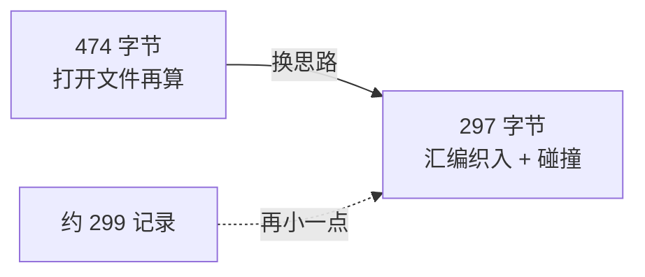
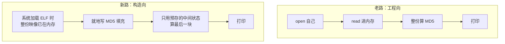
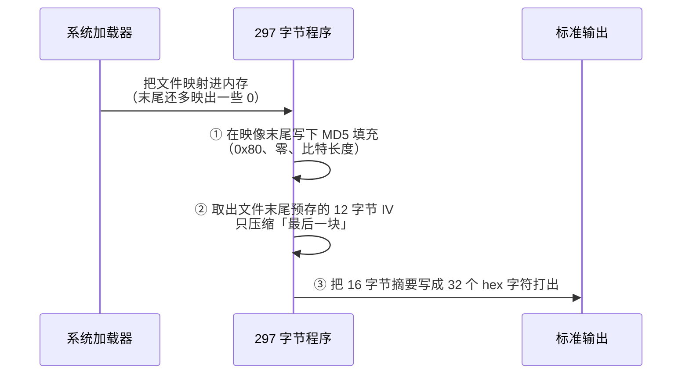
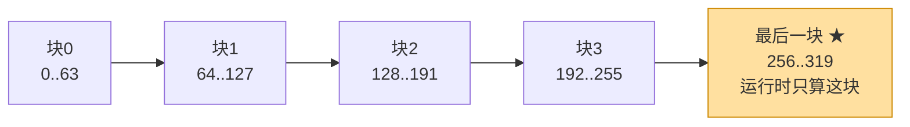
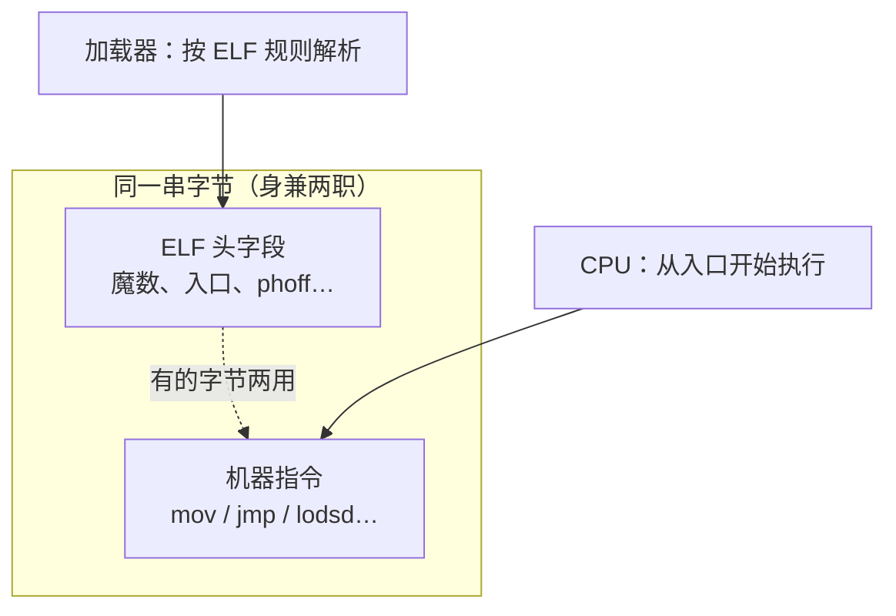
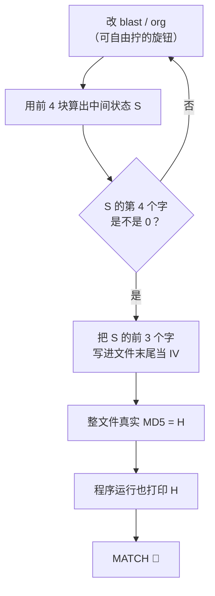
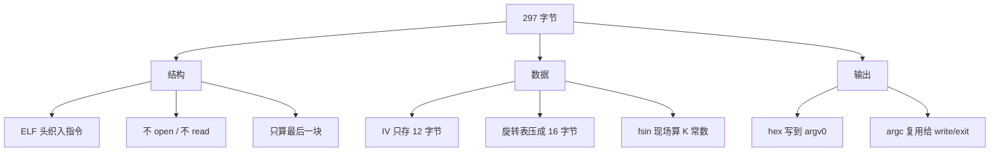
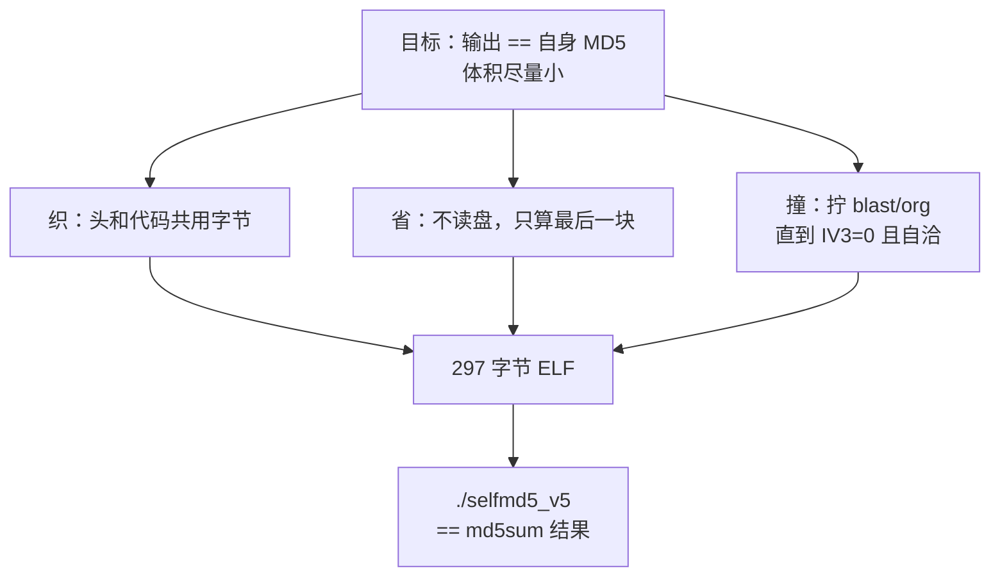

# 297 字节自打印 MD5：小白向图解

> 一句话：**做一个会「报出自己指纹」的超小 Linux 程序**，最终只要 **297 字节**。

> **说明：** 本 297 字节方案由 **纯 AI 独立完成**（设计、汇编、碰撞搜索与验证），不是人工手写缩小的。

本文只讲**最终方案**，不讲中间踩坑过程。配套源码在仓库的 [`new5/`](../new5/)。

---

## 1. 这道题在问什么？

比赛要求写一个 **64 位 ELF 可执行文件**（Linux 下那种直接 `./xxx` 就能跑的程序），它运行后打印的字符串，必须**正好等于**自己文件内容的 MD5。

```text
./selfmd5_v5
cc10068c9e89450201c84f848400fc66

md5sum selfmd5_v5
cc10068c9e89450201c84f848400fc66  selfmd5_v5
        ↑ 两边一模一样才算过关
```

| 名词 | 人话 |
|------|------|
| **ELF** | Linux 可执行文件的格式，开头通常是字节 `7f 45 4c 46`（`\x7fELF`） |
| **MD5** | 把任意文件「搅成」固定 32 个十六进制字符的指纹；改一个字节，指纹就变 |
| **自打印** | 程序输出 = 自己的 MD5，像照镜子 |

原仓库那条路是「打开自己 → 读文件 → 算 MD5 → 打印」，做到了 **474** 字节。网上还有人做到大约 **299**。  
本方案换思路后到了 **297**（比 299 小 2，比 474 小 177）。



---

## 2. 两条路：读自己 vs 不读自己



老路好理解，但 `open` / `read` / 完整 MD5 代码都要占地方。  
新路的关键洞察：

> 程序一旦被加载，**它自己的字节已经躺在内存里了**。何必再打开磁盘上的自己？

剩下的难题变成：怎么让「程序算出来的指纹」和「文件真实指纹」永远对得上——这靠后面的**碰撞定点**解决。

---

## 3. 最终方案总览（三步）

程序跑起来只干三件小事：



| 步骤 | 做什么 | 为什么省空间 |
|------|--------|--------------|
| ① 就地填充 | 在内存映像尾部写 `0x80` 和长度 | 不用另开大缓冲 |
| ② 只算最后一块 | 前面块的结果事先算好写进文件（叫 IV） | 运行时 MD5 循环大幅变短 |
| ③ 打印 hex | 写到 `argv[0]` 缓冲区再 `write` | 少申请一块输出内存 |

---

## 4. 图解一：文件在内存里长什么样

297 字节落在「256～319」这一档时，MD5 会把它看成：

- **前 4 个整块**：字节 `0～255`（每块 64 字节）
- **最后一块**：从偏移 `256` 开始，含文件尾巴 + 填充



更细一点看尾巴（人话版）：

```text
偏移:  0 ........................ 256 ...... 285 .. 297 ...... 312 .. 319
       |<---- 文件前 256 字节 ---->|<-- 文件尾 -->|IV| 0x80 零 |长度|
                                   ^
                                   运行时只「压缩」从这里开始的 64 字节
```

| 名词 | 人话 |
|------|------|
| **块 / block** | MD5 每次啃 64 字节，叫一块 |
| **填充 padding** | MD5 规定：数据后先跟一个 `0x80`，再补零，最后 8 字节写「原来有多少比特」 |
| **IV** | 中间状态（4 个 32 位整数）。这里故意让第 4 个恒为 0，文件里只存前 3 个 = **12 字节** |

`PT_LOAD` 的 `memsz`（内存里占多长）大于 `filesz`（文件里多长），所以加载后文件后面会多出一片零——正好拿来当填充场地，**不必再 `read` 文件**。

---

## 5. 图解二：ELF 头「织」进代码

普通程序：ELF 头是一段「说明书」，代码另起一段。  
本方案：说明书字段和机器指令**挤在同一串字节里**——同一段数据，加载器当头部读，CPU 当指令跑。



可以把它想成**一语双关**：

```text
普通写法：  [厚厚的 ELF 头][代码][数据]     ← 各过各的，浪费
织入写法：  [头和代码缠在一起的细面条]     ← 297 字节够用
```

常见织入点（对照 `new5/selfmd5_v5.asm`）：

- 入口就在文件很靠前的位置（跳过 `\x7fELF` 魔数后立刻开干）
- `e_phoff = 0x38`：程序头（program header）嵌在指令中间
- `p_vaddr` / 入口 / 指向 IV 的地址，都跟所选的加载基址 `org` 绑在一起

---

## 6. 图解三：为什么要「碰撞」？定点从哪来？

矛盾在这里：

1. 你改文件里任何一个字节 → **真实 MD5 变了**
2. 程序打印的是「用文件里存的 IV 去算最后一块」的结果  
3. 要两者相等，IV 还必须等于「前 4 块压出来的真实中间状态」

所以这是一个**自己咬自己尾巴**的环：



| 旋钮 | 是什么 | 作用 |
|------|--------|------|
| **blast** | `start3` 里 3 个可随意填的字节 | 微调文件内容，几乎不影响结构 |
| **org** | 页对齐的加载基址（如 `0x9ef000`） | 连带着改入口、`p_vaddr`、取 IV 的地址 |

搜索条件很单纯：**拧旋钮，直到中间状态第 4 个字为 0**。  
为 0 之后，程序里一句 `xor edi,edi` 就能变出第 4 个字，文件少存 4 字节。

当前冻结命中（已写进 asm，一般不用再搜）：

| 项 | 值 |
|----|-----|
| org | `0x9ef000` |
| blast | `c0c799` |
| IV | `6b2ff0ee c494181d ca6e2e13` |
| MD5 | `cc10068c9e89450201c84f848400fc66` |

---

## 7. 汇编里还藏了哪些「瘦身术」？

面向小白只需记住：**能共用的就不重复存**。



再补几个人话注释：

| 技巧 | 人话 |
|------|------|
| `fsin` 算 K[i] | MD5 需要 64 个魔术常数；用正弦指令现场算，比把表写死更省 |
| 寄存器里跑 MD5 | 少用内存临时变量，指令更短 |
| `div` + 指针奇偶打 hex | 把一字节拆成两个十六进制字符；借助地址奇偶，高低半字节都能打出 |
| 复用 `argc`/`argv` | 系统启动时栈上已有参数，拿来当长度和缓冲区 |

---

## 8. 自己动手：构建与验证

依赖：`nasm`、`python3`（可选：`gcc` 若要重跑碰撞搜索）。

```bash
cd new5
python3 build_v5.py
```

成功时大致会看到：

```text
size=297
output=cc10068c9e89450201c84f848400fc66
md5sum=cc10068c9e89450201c84f848400fc66
MATCH
```

手动对照也行：

```bash
wc -c selfmd5_v5          # 应为 297
./selfmd5_v5; echo
md5sum selfmd5_v5         # 两行数字相同即过关
```

等价手工汇编：

```bash
nasm -f bin -o selfmd5_v5 selfmd5_v5.asm
chmod +x selfmd5_v5
```

> 碰撞值已经写死在 `selfmd5_v5.asm` 里。只有你大改了指令布局，才需要重新跑 `search_v5.c`。

---

## 9. 一张图收束



---

## 10. 相关文件

| 路径 | 内容 |
|------|------|
| [`new5/selfmd5_v5.asm`](../new5/selfmd5_v5.asm) | 最终汇编源码（含冻结的 org / blast / IV） |
| [`new5/selfmd5_v5`](../new5/selfmd5_v5) | 297 字节成品 |
| [`new5/build_v5.py`](../new5/build_v5.py) | 一键汇编 + MATCH 检查 |
| [`new5/search_v5.c`](../new5/search_v5.c) | 可选：重新搜索 IV |
| [`new5/README.md`](../new5/README.md) | 给熟悉细节的人看的短笔记 |

如果你只想「先跑通再慢慢啃原理」：直接去 `new5/` 执行 `python3 build_v5.py` 即可。
